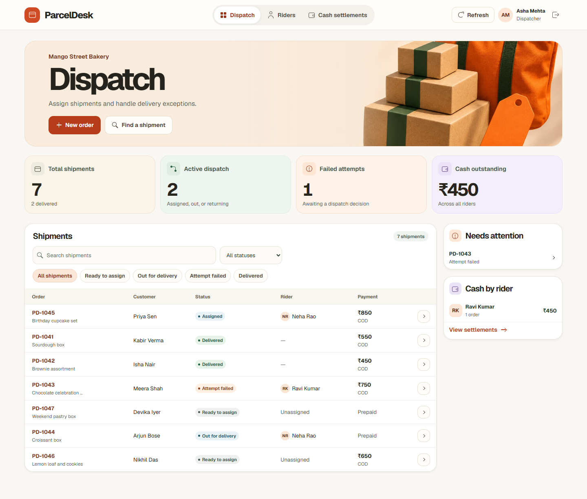

# ParcelDesk

A local delivery operations app for shops that take their own orders and dispatch their own riders. The dispatcher manages parcel handoffs and failed attempts, riders update deliveries from a phone, and customers can open a tracking link. At close of day, the shop can see the orders behind each rider’s cash handover.

**Backend** · Node.js, Express, TypeScript, PostgreSQL, SQL via **pg**, and cookie sessions stored in PostgreSQL.



## Run the demo

With Node.js 22 or newer installed:

```sh
npm ci
npm run demo
```

Open [localhost:3000](http://localhost:3000). The demo command starts PostgreSQL locally, creates seven sample orders on first run, and starts Express. Select **Dispatcher**, **Ravi**, or **Neha** on the sign-in screen. The demo database persists in **.local-db/demo**. Stop the process with Ctrl+C. Set the **PORT** environment variable if port 3000 is occupied.

With Docker, run **docker compose up --build** and open the same URL. To use an existing PostgreSQL instance, copy **.env.example** to **.env**, enter your database URL, then run **npm run db:seed** followed by **npm run dev**. To build compiled JavaScript, run **npm run build** and **npm start**.

The seeded accounts share the local demo password **ParcelDeskDemo!**. Their emails are **dispatch@parceldesk.demo**, **ravi@parceldesk.demo**, and **neha@parceldesk.demo**. Keep the demo instance on loopback.

For a deployment with real users, start with a fresh database and set **DEMO_MODE=false**. Provide **SHOP_NAME**, **DISPATCHER_NAME**, **DISPATCHER_EMAIL**, and **DISPATCHER_PASSWORD** through your environment and run **npm run db:provision** once to create the shop and dispatcher. In the built image, the equivalent is **node dist/setup.js provision**. The dispatcher adds riders from the dashboard. Configure HTTPS, a strong session secret, and **SECURE_COOKIES=true**. **TRUST_PROXY=true** assumes one trusted reverse proxy. The public tracking view exposes shipment status, shop name, reference, and update time.

## Interview walkthrough

Open two browser profiles so they can hold different sessions.

1. As **Dispatcher**, open **PD-1043**. Ravi’s first attempt failed because the customer was unavailable. Select **Request return**, then **Confirm return to shop** and assign Neha.
2. As **Neha**, open **PD-1043**, confirm pickup, and confirm delivery. Back in the dispatcher view, refresh and open the order to see both attempts and the return between them. Open the tracking link to see the customer view.
3. As **Dispatcher**, open **Cash settlements**, record a handover for Neha, and enter **₹650** with a note. The settlement history links **PD-1043** to **₹750 expected**, **₹650 received**, and a **₹100 shortfall**.
4. Run **npm run test:local**. The HTTP integration suite races two assignments, retries the same completion concurrently, and tries a delayed update from a rider whose assignment ended.

## How the backend works

```text
Dispatcher dashboard ─┐
Rider view ───────────┼── Express ── operations.ts ── PostgreSQL
Customer tracking ────┘                                  │
                         shipments, assignments, attempts, cash and sessions
```

| Rule | Implementation |
| --- | --- |
| One active assignment | A row lock on the shipment serializes actions. A partial unique index also enforces one active assignment in PostgreSQL. |
| Custody survives a failed attempt | Failed and return-requested shipments retain the assignment. The dispatcher confirms physical receipt before the backend closes it. |
| Delayed rider actions stay tied to the original assignment | Pickup and delivery requests carry the assignment ID. The service checks the rider and the ID against the current assignment. |
| One delivery produces one COD entry | The attempt, shipment update, assignment close, cash entry, and timeline event commit together. Repeating the same submission returns the original attempt. |
| A settlement traces back to its orders | The dispatcher selects open entries. PostgreSQL reserves them in the settlement transaction. Amounts use integer paise and differences require a note. |
| Private operations stay scoped to the shop | Sessions identify the actor. Role checks and shop-scoped queries protect private endpoints. The public tracking route looks up an opaque token. |

### API

| Method and path | Purpose |
| --- | --- |
| `POST /api/login`, `POST /api/logout`, `GET /api/me` | Session management. |
| `GET /api/shipments` | List shipments. Send the opaque `next` cursor as `before` to load another page. Rider lists show their active assignments. |
| `POST /api/shipments` | Create a shipment with `reference`, `customer`, `address`, `description`, `payment`, and `cod_paise`. |
| `GET /api/shipments/:id` | Shipment detail with active assignment ID, activity, and delivery attempts. |
| `POST /api/shipments/:id/actions` | Dispatcher actions accept `kind` values `assign`, `unassign`, `retry`, `request_return`, and `confirm_return`. `assign` needs `rider_id`. Rider actions `pickup` and `attempt` need `assignment_id`. An attempt also needs a UUID `submission_id`, `outcome` of `delivered` or `failed`, and a `reason` when it failed. |
| `GET /api/summary`, `GET /api/riders`, `POST /api/riders` | Dispatcher totals, rider workload, and rider accounts. Create an account with `name`, `email`, and `password`. |
| `GET /api/cash`, `POST /api/settlements` | Open entries, settlement history, and cash handover. Settlement accepts `rider_id`, `entry_ids`, `submission_id`, `received_paise`, and a `note` for a variance. |
| `GET /api/track/:token` | Public shipment status. |
| `GET /health` | Application and database readiness. |

### Verify

```sh
npm run build
npm run test:local
```

The local test command starts a fresh real PostgreSQL database. To run against a PostgreSQL instance you manage, set **TEST_DATABASE_URL** to a disposable database and run **npm test**. The tests create records in that database. The GitHub Actions workflow runs the build and integration suite against a PostgreSQL service.

## Résumé example

> Built a Node.js and PostgreSQL delivery operations app covering dispatch, failed deliveries, rider handoffs, and COD settlement. Used SQL transactions and integration tests to verify safe concurrent assignment and prevent duplicate cash entries.
